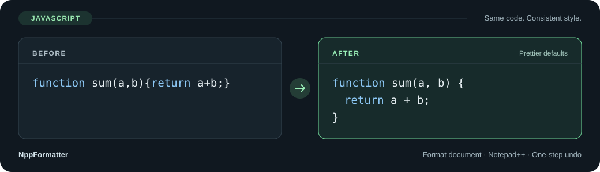

<a id="top"></a>

<h1 align="center">NppFormatter</h1>

<p align="center"><strong>Your editor. Your tools. Your formatting rules.</strong></p>
<p align="center">Format code inside Notepad++ with Prettier, project-aware settings, and one-step undo.</p>

<p align="center">
  <a href="https://github.com/oiltea94/npp-formatter/actions/workflows/ci.yml"></a>
  
  
  
</p>

<p align="center"><strong>English</strong> · <a href="README.zh-CN.md">简体中文</a></p>

<p align="center">
  <a href="#quickstart">Get started</a> ·
  <a href="#languages">Languages</a> ·
  <a href="#usage">Usage</a> ·
  <a href="#troubleshooting">Troubleshooting</a> ·
  <a href="#development">Build &amp; contribute</a>
</p>

<p align="center">
  
</p>

Inspired by [Formatter for Sublime Text](https://packages.sublimetext.com/packages/Formatter), NppFormatter is building toward a configurable home for formatting and text transformation tools in Notepad++. **Prettier is the first working integration.**

> **Current scope:** version 0.2.0 formats whole documents with Prettier, offers 16 built-in language choices and 7 optional languages, and checks your formatting environment. You install the external tools yourself; the plugin neither bundles nor installs Node.js, Prettier, or language packages. More adapters and text transformations are on the [roadmap](#roadmap).

## Why NppFormatter?

| What you need | What the plugin does |
|---|---|
| Consistent formatting across a project | Reads Prettier configuration, EditorConfig, and the nearest `.prettierignore` for saved files |
| A quick cleanup without leaving the editor | Formats the current buffer, including unsaved edits, and maps the caret into the result |
| An easy way back | Applies changes in one undo step; unchanged output adds no undo entry |
| Control over your tools | Uses your chosen Node.js executable and Prettier installation, with separate Auto-detect buttons |
| Help with pasted or mixed-language content | Offers document language selection, a one-time override, and explicit recovery after parser errors |
| A responsive editor | Runs formatting in the background and discards results when the document or editing state changes |

<details>
<summary>View the formatting example as text</summary>

Before:

```javascript
function sum(a,b){return a+b;}
```

After, using Prettier defaults:

```javascript
function sum(a, b) {
  return a + b;
}
```

Project settings can change indentation, quotes, semicolons, and line endings.

</details>

## Quickstart

### 1. Install your formatter

Install [Node.js](https://nodejs.org/) **18 or later**, then install **Prettier 3.x**. For use across projects:

```powershell
npm install --global prettier@3
```

Prefer a project-local installation? Run `npm install --save-dev --save-exact prettier@3` in that project instead. The plugin always uses the package selected in Settings; opening another project does not automatically switch Prettier installations.

### 2. Get the matching plugin

Use a manual-install ZIP from [Releases](https://github.com/oiltea94/npp-formatter/releases) when a tagged release is available. **Until then, download a tested build from [GitHub Actions](https://github.com/oiltea94/npp-formatter/actions/workflows/ci.yml):**

1. Sign in to GitHub and open a successful run for `main`.
2. Under **Artifacts**, download and extract **release-assets**.
3. Choose the ZIP matching **Notepad++'s architecture**, then extract that ZIP too.

| Your Notepad++ | Manual-install ZIP for 0.2.0 |
|---|---|
| x86 / 32-bit | `NppFormatter-0.2.0-x86.zip` |
| x64 / 64-bit | `NppFormatter-0.2.0-x64.zip` |
| ARM64 | `NppFormatter-0.2.0-arm64.zip` |

32-bit Notepad++ on 64-bit Windows still needs **x86**. Node.js runs as a separate process and only needs to be compatible with Windows; its architecture need not match the plugin. CI tests the plugin with Notepad++ **8.9.6** on all three architectures.

Close Notepad++, then copy the extracted **NppFormatter** folder into the editor's **plugins** folder. Back up an existing plugin folder before upgrading. Keep **NppFormatter.dll** and **bridge.cjs** together, along with the READMEs and license notices.

Use the manual ZIP above for this installation. Files ending in `-plugin-admin.zip` have a different layout for Plugins Admin. Generating those packages does not mean the plugin is already available in the official catalog.

### 3. Detect the paths and format

1. Restart Notepad++ and open **Plugins → NppFormatter → Settings...**.
2. Click **Auto-detect** for **Node.js**, then for **Prettier**. For a project-local installation, open a saved file from that project first.
3. Click **Save**.
4. Open a supported document and choose **Plugins → NppFormatter → Format document**.

Assign a shortcut under **Settings → Shortcut Mapper → Plugin commands**. Use **Ctrl+Z** to undo a formatting change.

<details>
<summary>Detection details and manual path lookup</summary>

Detection fills the fields; it does not install dependencies or save settings automatically. Failure preserves the previous value. **Cancel** discards unsaved changes, including while detection is running.

- **Node.js:** checks `PATH`, common install locations, NVM/Volta locations, and the existing field; validates Node.js 18+ and resolves the real executable.
- **Prettier:** uses the selected Node.js; searches the saved file's project and ancestors, the existing field, npm's global root, and common global locations. Untitled documents skip the project search. Detection checks package metadata without executing project configuration or Prettier package code.

If detection finds nothing, install the dependency or use **Browse...**. Restart Notepad++ after changing `PATH`.

```powershell
# Actual Node.js executable
node -p "process.execPath"

# Global Prettier package directory
Join-Path (npm root -g) 'prettier'

# Project-local Prettier package directory; run inside that project
node -p "require('path').dirname(require.resolve('prettier/package.json'))"
```

Select the Prettier directory containing `package.json`, rather than its `bin` directory or `prettier.cmd`. The Browse dialog selects `package.json` and fills in its directory.

</details>

## Languages

The language picker offers **16 built-in choices and 7 optional languages: Java, XML, PHP, SQL, Properties, TOML, and Shell / Bash**. Built-in formats need only Prettier; each additional language needs its optional package. Actual syntax support depends on your installed formatter versions.

| Language / picker choice | Common saved-file extensions |
|---|---|
| JavaScript / JSX | `.js`, `.mjs`, `.cjs`, `.jsx` |
| TypeScript / TSX | `.ts`, `.mts`, `.cts`, `.tsx` |
| JSON | `.json` |
| JSON5 | `.json5` |
| JSONC | `.jsonc` |
| HTML | `.html`, `.htm` |
| CSS | `.css` |
| SCSS | `.scss` |
| Less | `.less` |
| YAML | `.yaml`, `.yml` |
| Markdown | `.md`, `.markdown` |
| MDX | `.mdx` |
| Handlebars | `.hbs`, `.handlebars` |
| GraphQL | `.graphql`, `.gql` |
| Vue | `.vue` |
| Angular HTML | `.component.html` |
| **Java — optional package** | `.java` |
| **XML — optional package** | `.xml`, `.svg`, `.xsd`, `.xsl`, `.xslt`, `.xaml`, `.resx` |
| **PHP — optional package** | `.php`, `.phtml` |
| **SQL — optional package** | `.sql` |
| **Properties — optional package** | `.properties` |
| **TOML — optional package** | `.toml` |
| **Shell / Bash — optional package** | `.sh`, `.bash` |

**Additional saved-file formats:** Flow (`.js.flow`), MJML (`.mjml`), PostCSS (`.pcss`, `.postcss`), and JSON.stringify-style JSON (`.importmap`). Prettier infers these from the path; they have no dedicated picker entries. Project configuration can also select a built-in parser such as `lwc`. The extensions above are examples, not an exhaustive list.

**Untitled documents:** automatic Notepad++ language mapping covers JavaScript, TypeScript, Java, XML, PHP, SQL, Properties, TOML, Shell, JSON, JSON5, HTML, CSS, and YAML. Use **Format with language...** for other picker choices. MDX and Handlebars are distinct formats; selecting Markdown or HTML is not equivalent. C/C++ and Python formatting remain planned.

### Optional Java support

For a global Prettier installation:

```powershell
npm install --global prettier-plugin-java@2.11.0
```

For a project-local installation, use `npm install --save-dev --save-exact prettier-plugin-java@2.11.0` in the same project as Prettier. Then open a `.java` file or select **Java** when formatting. No Java-specific project configuration is required.

Saved Java files honor an explicitly configured Java parser plugin first. Otherwise, discovery checks the file's project and ancestors, the configuration location, and the selected Prettier installation. Untitled documents use the installation alongside the selected Prettier. Missing packages show an installation message and preserve the document; install and retry. A discovered package's load error is reported without silently switching to another copy.

### Optional XML support

For a global Prettier installation:

```powershell
npm install --global @prettier/plugin-xml@3.4.2
```

For a project-local installation, use `npm install --save-dev --save-exact @prettier/plugin-xml@3.4.2` in the same project as Prettier. Open an XML file, including `pom.xml` or `build.xml`, or one of the XML-based formats listed above. For an untitled document, select **XML** in Notepad++ or in **Format with language...**. No separate executable or additional path setting is needed.

XML uses the same package discovery and missing-dependency behavior as Java. Explicit project plugins and parser choices take precedence. Other XML-based extensions can use the **XML** picker or a project parser override.

The default `xmlWhitespaceSensitivity: "strict"` preserves meaningful whitespace inside elements, so compact XML may remain on one line. For files where that whitespace is insignificant, add an override to your Prettier configuration:

```json
{
  "overrides": [
    {
      "files": "*.xml",
      "options": { "xmlWhitespaceSensitivity": "ignore" }
    }
  ]
}
```

JSONC, MDX, and Handlebars use Prettier's built-in parsers and need no additional package.

### Optional PHP, SQL, and Properties support

Install only the packages you need alongside your global Prettier:

```powershell
npm install --global @prettier/plugin-php@0.26.0
npm install --global prettier-plugin-sql@0.20.0
npm install --global prettier-plugin-properties@0.3.1
```

For a project-local installation, replace `--global` with `--save-dev --save-exact` and run the command in that project. These packages use the same discovery and missing-dependency guidance as Java and XML. No PHP executable or database connection is needed. Untitled files can follow the matching Notepad++ language or use the language picker.

- **PHP:** formats `.php` and `.phtml`. Pure PHP is the primary use case; the upstream plugin considers mixed PHP/HTML formatting unstable.
- **SQL:** formats `.sql`. Select the default **SQL dialect** in Settings; it starts with standard SQL and includes MySQL, MariaDB, PostgreSQL, SQLite, SQL Server, Oracle, BigQuery, and other dialects. Save to apply; Cancel discards the change. Saved files honor the project's `language` option first. A project selecting `formatter: "node-sql-parser"` uses its own `database` option instead. The default engine does not support stored procedures or custom statement delimiters.
- **Properties:** formats `.properties`, including comments, duplicate keys, and escaped values. Output keeps Unicode by default. Project options `escapeNonLatin1: true` and `keySeparator` control Unicode escapes and key/value separators. The editor buffer must still be UTF-8.

To use PostgreSQL for a project's SQL files, add this Prettier override:

```json
{
  "overrides": [
    { "files": "*.sql", "options": { "language": "postgresql" } }
  ]
}
```

### Optional TOML and Shell support

Install the packages you need alongside your global Prettier:

```powershell
npm install --global prettier-plugin-toml@4.1.0
npm install --global prettier-plugin-sh@0.20.2
```

For project-local packages, replace `--global` with `--save-dev --save-exact`. Package discovery follows the same rules as Java and XML. Nothing is downloaded or installed by NppFormatter.

- **TOML:** requires Node.js **20+**. Formats `.toml`, including `pyproject.toml` and `Cargo.toml`. npm installs the platform binding required by the package; no separate formatter executable is configured.
- **Shell / Bash:** requires Prettier **3.6+**. Formats `.sh` and `.bash`; other shell filenames can use **Format with language...**. Choose **Bash**, **POSIX sh**, **mksh**, or **Bats** in the **Shell dialect** setting. The default is Bash. Project `variant` values (`1`, `2`, `4`, `8`, respectively) override this setting. Scripts are formatted without being executed. This does not add PowerShell, Windows batch, Dockerfile, or ignore-file formatting.

To enforce POSIX syntax for a project's shell scripts:

```json
{
  "overrides": [
    { "files": "*.sh", "options": { "variant": 2 } }
  ]
}
```

### Check your formatting environment

Open **Settings → Check formatting environment** to inspect the currently entered paths before saving. The report shows Node.js and Prettier versions, the document used for project discovery, and each optional package's version, location, and status: **Available**, **Not installed**, or **Check failed**. Available packages have passed a small formatting sample, including loading native or WASM dependencies. This checks the installation; it does not validate every document or every project option.

The check runs in the background, can be cancelled by closing Settings, and neither installs packages nor saves settings. Changing either path clears the previous report. For project dependencies, activate a saved document in that project and rerun the check. External diagnostics retain their original language.

## Usage

| Command | What it does |
|---|---|
| **Format document** | Formats the entire current buffer, including unsaved changes |
| **Format with language...** | Overrides the language for this operation, keeping the file type, remembered choice, project options, and ignore rules |
| **Settings...** | Configures Node.js, Prettier, SQL/Shell dialects and timeout; checks installed formatting tools |
| **About** | Shows the version, supported formats, runtime requirements, and clickable project homepage |

**Saved files** use their path for parser inference and project configuration. **Untitled files** use a supported Notepad++ document language; plain text containing valid JSON is detected automatically. Otherwise, a picker appears and remembers your choice for that document during the current session.

Replacing all text, clearing and pasting again, saving or closing the document, or changing its Notepad++ language resets a remembered choice. Ordinary edits and formatting preserve it. When parsing fails, choose **Show error details** or **Choose another language...** to retry explicitly. Dependency, configuration, and timeout errors keep their own diagnostics.

<details>
<summary>Selection, recovery, and existing settings</summary>

- Formatting always applies to the whole document. A normal selection collapses to the mapped caret afterward; multiple carets and rectangular selections are outside the current scope.
- Editing, switching documents, saving, or moving the caret/selection during a request can discard its result. Retry once ready. Errors and timeouts leave the original text intact.
- A corrected language is remembered only when the untitled document was using a remembered choice. For a saved file or a supported Notepad++ language, recovery applies to that operation only.
- Untitled files have no project path for configuration lookup. The old global `UntitledParser` setting is ignored and removed on the next settings save; dependency paths and timeout are retained.

</details>

### Project rules

Saved files use Prettier configuration, EditorConfig, and the nearest `.prettierignore`. For example, a `.prettierrc` can contain:

```json
{
  "singleQuote": true,
  "semi": false,
  "tabWidth": 2
}
```

Ignored files are skipped. The document's LF or CRLF setting is used unless project configuration overrides it. JavaScript-based configuration and extra Prettier plugins may require a newer Node.js version or additional dependencies.

### Your editor's language

The interface follows **Notepad++**, with **English, Simplified Chinese, and Traditional Chinese** translations. Hong Kong Chinese uses Traditional Chinese; other locales fall back to English. Changing the editor language updates menus and an open Settings window without losing unsaved fields or requiring a restart. External tool diagnostics retain their original language; Windows supplies standard file-picker and message-box buttons.

### Settings and limits

| Item | Current behavior |
|---|---|
| Buffer | UTF-8, up to **8 MiB**, one ordinary caret or selection |
| Timeout | **10,000 ms** by default; accepts **1,000–120,000 ms** and bounds one formatting request |
| Undo / no change | One undo step for changed output; no extra step for unchanged output |
| Bookmarks and folding | May move when the entire buffer is replaced |
| Accessibility and display scaling | Settings high-DPI and screen-reader behavior still needs broader release testing |

Settings live in `NppFormatter.ini` in the plugin configuration directory supplied by Notepad++. Saving existing settings backs up the previous version as `NppFormatter.ini.bak`. Close Settings and restore that backup to recover the previous configuration; the next formatting request reloads it. To upgrade or roll back, close Notepad++ and replace the plugin folder with the new or backed-up copy. To uninstall, remove the plugin folder; keep or remove the INI separately.

## Troubleshooting

| Symptom | Next step |
|---|---|
| Plugin menu is missing | Match the DLL to Notepad++'s architecture, check the plugin folder, and restart |
| Formatting opens Settings | Configure both dependency paths and save |
| Node.js or Prettier fails to load | Re-run Auto-detect; select the real `node.exe` and the Prettier package containing `package.json` |
| Pasted code uses the wrong language | Use **Format with language...**; whole-text replacement resets remembered choices |
| Parser or syntax error | Open the original diagnostic, correct the code, or explicitly choose another language |
| Java package is missing | Install `prettier-plugin-java` as described above, then retry |
| XML package is missing | Install `@prettier/plugin-xml` in the project or alongside the selected Prettier, then retry |
| PHP / SQL / Properties package is missing | Install the corresponding package above, then retry |
| SQL dialect error | Select the matching dialect in Settings or set the project’s `language` option |
| Compact XML stays on one line | XML preserves significant whitespace by default; see the XML configuration above |
| File is ignored / result discarded | Check `.prettierignore`; retry after editing, saving, or switching documents |
| Request times out | Inspect project configuration and plugins; adjust the request timeout if needed |
| UTF-8 is required | Choose **Encoding → Convert to UTF-8** and retry |
| Buffer or selection is rejected | Stay within 8 MiB and use one ordinary caret or selection |

Still stuck? [Open an issue](https://github.com/oiltea94/npp-formatter/issues/new) with the plugin, editor, Node.js, and Prettier versions; a minimal sample; relevant configuration; and the complete error or status message.

## Development

On Windows, install **Git, Node.js/npm, Python 3.12+, and PowerShell**, then run:

```powershell
git clone https://github.com/oiltea94/npp-formatter.git
cd npp-formatter
npm ci
python scripts/bootstrap.py
powershell -NoProfile -ExecutionPolicy Bypass -File scripts/build.ps1 -Architecture all
```

The bootstrap downloads SHA-256-pinned **LLVM-MinGW 20261104 / UCRT**. The compiler runs on Windows x64 or through x64 emulation on Windows 11 ARM64 and cross-compiles all three targets. Supply an existing toolchain through `-Toolchain` or `LLVM_MINGW_ROOT`. Build output goes to `dist/`; development dependencies and build tools stay outside the install ZIPs.

<details>
<summary>Build options, tests, and source layout</summary>

`-Architecture` accepts `x86`, `x64` (default), `arm64`, or `all`. `-SkipTests` skips bridge/native tests but still verifies package contents. `-RequireRuntimeTests` requires a host that can execute the target. A normal cross-build on x64 skips ARM64 runtime tests explicitly; it is not a runtime pass.

| Command | Purpose |
|---|---|
| `npm test` | Real Prettier and optional language package integration tests |
| `python -m unittest discover -s tests -p test_artifacts.py` | Check built DLLs and ZIP rejection cases |
| `python -m unittest discover -s tests -p test_catalog.py` | Check catalog updates and PR reuse without API writes |
| `python tests/download_npp.py --arch x64` | Download the hash-verified portable test editor |
| `python tests/editor_smoke.py --arch x64` | Exercise a matching editor; use `NPP_EXE` to select its executable |

Editor tests cover English, Simplified Chinese, and Traditional Chinese, including live language changes. They use an isolated editor copy, verify its architecture, and leave the active installation alone. Use `--language en`, `zh-CN`, or `zh-TW` for a single locale, and 64-bit Python for x64/ARM64 editors. CI runs matching native process and editor tests on `windows-latest` and `windows-11-arm`.

The native plugin and process management live in `src/`, the Prettier adapter in `bridge/`, and tests in `tests/`. The prototype starts one Node.js process per request and allows one active request at a time. The [product specification](https://github.com/oiltea94/npp-formatter/blob/main/docs/SPEC.md) records the current scope and intended architecture.

</details>

<details>
<summary>Release and Plugins Admin automation</summary>

The workflow follows the build → assembly → release → catalog structure used by [npp-yaml-properties](https://github.com/oiltea94/npp-yaml-properties).

| Trigger | Result |
|---|---|
| `main` push, pull request, or manual build | Tests all architectures and uploads `release-assets` plus bilingual `release-notes`; does not publish a Release |
| Push `vMAJOR.MINOR.PATCH` | Requires matching package/lockfile versions and a `CHANGELOG.md` entry; publishes only after all checks pass |
| Release publication | Verifies public assets and prepares a catalog proposal; submission is opt-in |
| Manual catalog workflow | Previews or submits a published tag without rebuilding |

`package.json` supplies the DLL and About versions. Add bilingual release notes before tagging. Verified attachments are uploaded to a draft before publication; existing releases are not overwritten. Each release contains three manual ZIPs, three Plugins Admin ZIPs, `manifest.json`, `SHA256SUMS`, and three catalog entry JSON files. Manual ZIPs contain the plugin folder; Plugins Admin ZIPs put the DLL and bridge at the archive root.

The catalog workflow defaults to `dry_run: true` and saves `official-catalog-proposal`. To submit, configure the `NPP_PLUGIN_LIST_TOKEN` Actions secret with push access to `oiltea94/nppPluginList` and permission to open PRs in `notepad-plus-plus/nppPluginList`, then select `dry_run: false`. Set the repository variable `NPP_CATALOG_AUTO_SUBMIT=true` to enable automatic submission after future tag releases.

Existing NppFormatter PRs are reused and reviewer notes preserved. Downgrades and a changed archive hash for the same version are rejected. Catalog failures can be retried independently. Metadata uses tested Notepad++ 8.9.6 as the minimum; official review and catalog distribution are still required. Actual Plugins Admin install/update/remove behavior remains to be validated.

</details>

## Roadmap

These are planned capabilities, not current menu commands:

| Next area | Intended result |
|---|---|
| Generic tool definitions | Register command-line tools through configuration |
| More adapters | C/C++ with clang-format; Python with Ruff |
| Tool selection | Per-language defaults, project overrides, and dependency diagnostics |
| Editing workflows | Selection formatting and format on save |
| Text transformations | Minifiers, converters, and ordered tool pipelines with one final undoable edit |

Process reuse, additional encodings, and improved bookmark/folding preservation are later work. Contributions are welcome: start with a focused issue, keep changes scoped, run the relevant checks, and update both README translations when behavior changes.

## Acknowledgments

- [Formatter for Sublime Text](https://packages.sublimetext.com/packages/Formatter) — inspiration for the broader tool-based workflow. NppFormatter is an independent project.
- [Notepad++](https://notepad-plus-plus.org/) and [Prettier](https://prettier.io/) — the editor and first formatter integration.
- [prettier-plugin-java](https://github.com/jhipster/prettier-java) — optional Java formatting.
- [@prettier/plugin-xml](https://github.com/prettier/plugin-xml) — optional XML formatting.
- [Awesome README](https://github.com/matiassingers/awesome-readme) — inspiration for this documentation's organization and presentation.

Third-party source versions and license notices are recorded in [third_party/README.md](https://github.com/oiltea94/npp-formatter/blob/main/third_party/README.md). Install packages include the applicable notices in `licenses/`.

<p align="center"><a href="#top">Back to top</a> · <a href="https://github.com/oiltea94/npp-formatter/blob/main/CHANGELOG.md">Changelog</a> · <a href="https://github.com/oiltea94/npp-formatter/issues">Issues</a></p>
