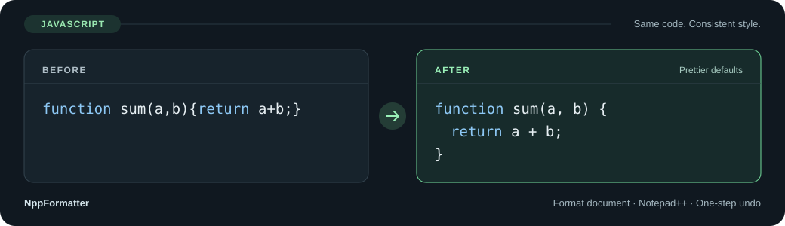

<a id="top"></a>

<h1 align="center">NppFormatter</h1>

<p align="center"><strong>熟悉的编辑器，你的工具，你的格式化规则。</strong></p>
<p align="center">在 Notepad++ 中使用 Prettier 格式化代码，遵循项目配置，支持一步撤销。</p>

<p align="center">
  <a href="https://github.com/oiltea94/npp-formatter/actions/workflows/ci.yml"></a>
  
  
  
</p>

<p align="center"><a href="README.md">English</a> · <strong>简体中文</strong></p>

<p align="center">
  <a href="#quickstart">快速开始</a> ·
  <a href="#languages">支持的语言</a> ·
  <a href="#usage">日常使用</a> ·
  <a href="#troubleshooting">常见问题</a> ·
  <a href="#development">构建与参与</a>
</p>

<p align="center">
  
</p>

灵感来自 [Sublime Text 的 Formatter](https://packages.sublimetext.com/packages/Formatter)。NppFormatter 希望将多种格式化与文本转换工具接入 Notepad++，通过统一配置使用。**Prettier 是目前已实现的第一种接入。**

> **当前范围：** 0.1.0 原型支持使用 Prettier 格式化全文，Java 通过可选的 `prettier-plugin-java` 扩展支持。外部工具由用户自行安装；插件不捆绑或安装 Node.js、Prettier 和语言扩展包。更多适配器与文本转换功能见[路线图](#roadmap)。

> **`main` 分支尚未发布的新增功能：** 通过 `@prettier/plugin-xml` 支持 XML，并新增 JSONC、MDX、Handlebars 独立语言选项。这些功能需使用开发构建，已发布的 0.1.0 安装包尚未包含。

## 为什么使用 NppFormatter？

| 你的需要 | 插件如何处理 |
|---|---|
| 同一项目保持一致的代码风格 | 为已保存文件读取 Prettier 配置、EditorConfig 和最近的 `.prettierignore` |
| 在编辑器里快速整理代码 | 格式化当前缓冲区，包含未保存的修改，并将光标映射到结果中 |
| 随时恢复格式化前的内容 | 一步撤销整次修改；输出未变化时，不增加撤销记录 |
| 自己选择工具安装 | 使用指定的 Node.js 和 Prettier，两项依赖分别提供自动检测按钮 |
| 处理粘贴内容或切换代码语言 | 提供文档语言选择、仅本次生效的覆盖，以及解析失败后的显式重试 |
| 格式化时编辑器保持响应 | 后台执行，文档或编辑状态变化后丢弃过期结果 |

<details>
<summary>查看文本形式的格式化示例</summary>

格式化前：

```javascript
function sum(a,b){return a+b;}
```

使用 Prettier 默认设置格式化后：

```javascript
function sum(a, b) {
  return a + b;
}
```

项目配置可以改变缩进、引号、分号和换行符。

</details>

<a id="quickstart"></a>

## 快速开始

### 1. 安装格式化工具

安装 [Node.js](https://nodejs.org/) **18 或以上版本**，然后安装 **Prettier 3.x**。需要在不同项目中使用时，可全局安装：

```powershell
npm install --global prettier@3
```

希望使用项目内的版本？在项目目录执行 `npm install --save-dev --save-exact prettier@3`。插件始终使用配置中选定的包；打开其他项目不会自动切换 Prettier 安装。

### 2. 获取对应架构的插件

发布标签版本后，可从 [Releases](https://github.com/oiltea94/npp-formatter/releases) 获取手动安装 ZIP。**尚无正式发布包时，从 [GitHub Actions](https://github.com/oiltea94/npp-formatter/actions/workflows/ci.yml) 下载经过测试的构件：**

1. 登录 GitHub，打开 `main` 分支的一次成功运行。
2. 在 **Artifacts** 中下载并解压 **release-assets**。
3. 选择与 **Notepad++ 架构**一致的 ZIP，再解压这份安装包。

| 你的 Notepad++ | 0.1.0 手动安装包 |
|---|---|
| x86 / 32 位 | `NppFormatter-0.1.0-x86.zip` |
| x64 / 64 位 | `NppFormatter-0.1.0-x64.zip` |
| ARM64 | `NppFormatter-0.1.0-arm64.zip` |

64 位 Windows 上运行的 32 位 Notepad++ 仍需选择 **x86**。Node.js 作为独立进程运行，只需兼容当前 Windows，其架构无需与插件一致。CI 使用 Notepad++ **8.9.6** 测试全部三种架构。

关闭 Notepad++，将解压得到的 **NppFormatter** 文件夹复制到编辑器的 **plugins** 文件夹。升级前先备份已有插件文件夹。**NppFormatter.dll** 和 **bridge.cjs** 须放在一起，同时保留 README 和许可说明。

上述安装方式使用手动 ZIP。以 `-plugin-admin.zip` 结尾的文件采用 Plugins Admin 专用布局；生成这类安装包不代表插件已进入官方目录。

### 3. 检测路径，开始格式化

1. 重启 Notepad++，打开 **插件 → NppFormatter → 配置...**。
2. 依次点击 **Node.js** 和 **Prettier** 的**自动检测**按钮。使用项目内安装时，先打开该项目中一个已保存的文件。
3. 点击**保存**。
4. 打开支持的文档，选择 **插件 → NppFormatter → 格式化文档**。

可在 **设置 → 管理快捷键 → 插件命令** 中设置快捷键。格式化后按 **Ctrl+Z** 即可撤销本次修改。

<details>
<summary>自动检测细节与手动查找路径</summary>

检测只填入输入框，不会安装依赖或自动保存配置。检测失败保留原值；点击**取消**会放弃未保存的修改，也可在检测过程中取消。

- **Node.js：** 检查 `PATH`、常见安装位置、NVM/Volta 位置和现有输入，验证 Node.js 18+ 并解析真实可执行文件。
- **Prettier：** 使用选定的 Node.js，依次查找已保存文件的项目及上级目录、现有输入、npm 全局目录和常见全局位置。未保存文档跳过项目搜索。检测检查包元数据，不执行项目配置或 Prettier 包代码。

未检测到时，先安装依赖，或使用**浏览...** 手动选择。修改 `PATH` 后请重启 Notepad++。

```powershell
# Node.js 的真实可执行文件
node -p "process.execPath"

# 全局 Prettier 包目录
Join-Path (npm root -g) 'prettier'

# 项目内 Prettier 包目录；在该项目中执行
node -p "require('path').dirname(require.resolve('prettier/package.json'))"
```

选择包含 `package.json` 的 Prettier 包目录，避免选成 `bin` 目录或 `prettier.cmd`。浏览对话框通过选择 `package.json` 来填入其所在目录。

</details>

<a id="languages"></a>

## 支持的语言

开发构建的语言选择器提供 **16 个内置选项，以及 Java 和 XML**。内置格式只需 Prettier；Java 和 XML 各需一个可选扩展包。具体语法支持取决于安装的格式化工具版本。

| 语言 / 选择器选项 | 常见已保存文件扩展名 |
|---|---|
| JavaScript / JSX | `.js`、`.mjs`、`.cjs`、`.jsx` |
| TypeScript / TSX | `.ts`、`.mts`、`.cts`、`.tsx` |
| JSON | `.json` |
| JSON5 | `.json5` |
| JSONC | `.jsonc` |
| HTML | `.html`、`.htm` |
| CSS | `.css` |
| SCSS | `.scss` |
| Less | `.less` |
| YAML | `.yaml`、`.yml` |
| Markdown | `.md`、`.markdown` |
| MDX | `.mdx` |
| Handlebars | `.hbs`、`.handlebars` |
| GraphQL | `.graphql`、`.gql` |
| Vue | `.vue` |
| Angular HTML | `.component.html` |
| **Java — 可选扩展包** | `.java` |
| **XML — 可选扩展包** | `.xml`、`.svg`、`.xsd`、`.xsl`、`.xslt`、`.xaml`、`.resx` |

**已保存文件还支持：** Flow（`.js.flow`）、MJML（`.mjml`）、PostCSS（`.pcss`、`.postcss`）和 JSON.stringify 风格的 JSON（`.importmap`）。这些格式由 Prettier 根据路径推断，选择器中暂未提供独立选项。项目配置也可显式指定 `lwc` 等内置解析器。上表仅列出常见扩展名。

**未保存文档：** 自动跟随 Notepad++ 文档语言的映射包括 JavaScript、TypeScript、Java、XML、JSON、JSON5、HTML、CSS 和 YAML。其他选择器格式可通过**按指定语言格式化...** 使用。MDX 和 Handlebars 是独立格式，选择 Markdown 或 HTML 并不等价。C/C++ 和 Python 格式化仍在规划中。

### 可选的 Java 支持

Prettier 为全局安装时，执行：

```powershell
npm install --global prettier-plugin-java@2.11.0
```

项目内安装时，在安装 Prettier 的同一项目中执行 `npm install --save-dev --save-exact prettier-plugin-java@2.11.0`。随后打开 `.java` 文件，或在格式化时选择 **Java**。无需编写 Java 专用项目配置。

已保存的 Java 文件优先使用项目配置显式指定的 Java 解析器插件；否则依次查找文件所属项目及上级目录、配置文件位置、所选 Prettier 的安装位置。未保存文档使用所选 Prettier 同一位置的安装。依赖缺失时显示安装提示并保留原文，安装后重试即可。已找到的包加载失败时，报告原始错误，不会悄悄换用其他副本。

### 可选的 XML 支持（尚未发布）

如果 Prettier 是全局安装：

```powershell
npm install --global @prettier/plugin-xml@3.4.2
```

项目内安装时，在安装 Prettier 的同一项目中执行 `npm install --save-dev --save-exact @prettier/plugin-xml@3.4.2`。随后打开 XML 文件（包括 `pom.xml`、`build.xml`），或上表中的其他 XML 格式文件。未保存文档可在 Notepad++ 或**按指定语言格式化...** 中选择 **XML**。无需安装独立可执行工具，也无需新增路径配置。

XML 沿用 Java 的扩展查找顺序和缺失提示，优先遵循项目显式配置的插件和解析器。其他 XML 格式的扩展名可通过 **XML** 语言选项或项目解析器配置处理。

默认的 `xmlWhitespaceSensitivity: "strict"` 会保留元素内有意义的空白，因此紧凑 XML 可能仍保持单行。对于这些空白不影响含义的文件，可在 Prettier 配置中加入覆盖规则：

```json
{
  "overrides": [
    {
      "files": "*.xml",
      "options": { "xmlWhitespaceSensitivity": "ignore" }
    }
  ]
}
```

JSONC、MDX 和 Handlebars 使用 Prettier 内置解析器，无需额外安装扩展包。

<a id="usage"></a>

## 日常使用

| 命令 | 作用 |
|---|---|
| **格式化文档** | 格式化当前缓冲区全文，包含尚未保存的修改 |
| **按指定语言格式化...** | 仅本次覆盖语言选择，保留文件类型、记住的选择、项目选项和忽略规则 |
| **配置...** | 设置 Node.js、Prettier 和请求超时时间 |
| **关于** | 显示版本、支持的格式、运行要求，以及可点击的项目主页 |

**已保存文件**通过路径推断解析器并查找项目配置。**未保存文件**优先使用 Notepad++ 中受支持的文档语言；纯文本中的有效 JSON 会被自动识别。其他情况弹出语言选择窗口，选择仅在当前会话中为该文档记住。

整篇替换、清空后重新粘贴、保存或关闭文档、切换 Notepad++ 文档语言，都会清除记住的选择。普通编辑和格式化本身会保留它。解析失败时，可**查看错误详情**，或**重新选择语言...** 后显式重试；依赖、配置和超时错误保留各自的诊断。

<details>
<summary>选区、错误恢复与已有配置</summary>

- 格式化始终作用于全文。普通选区在完成后收拢到映射后的光标；当前原型暂不处理多光标或矩形选区。
- 请求期间编辑、切换文档、保存或移动光标与选区，可能导致结果被丢弃。准备好后重试即可；错误和超时保留原文。
- 仅当未保存文档原先使用记住的语言时，纠正后的选择才会被记住。已保存文件或使用 Notepad++ 受支持语言的文档，仅本次覆盖。
- 未保存文件没有用于查找项目配置的路径。旧的全局 `UntitledParser` 设置已忽略，并在下次保存配置时移除；依赖路径和超时时间保留。

</details>

### 遵循项目规则

已保存文件使用 Prettier 配置、EditorConfig 和最近的 `.prettierignore`。例如，`.prettierrc` 可包含：

```json
{
  "singleQuote": true,
  "semi": false,
  "tabWidth": 2
}
```

匹配忽略规则的文件会被跳过。默认沿用文档的 LF 或 CRLF 设置，项目配置可以覆盖它。JavaScript 编写的配置和额外的 Prettier 插件可能需要更新的 Node.js 或其他依赖。

### 跟随编辑器语言

界面跟随 **Notepad++**，提供**英文、简体中文和繁体中文**翻译。香港中文使用繁体中文，其他语言回退为英文。切换编辑器语言后，菜单和已打开的配置窗口会更新，保留未保存的输入，无需重启。外部工具诊断保持原文；标准文件选择框和消息框按钮由 Windows 提供。

### 设置与使用限制

| 项目 | 当前行为 |
|---|---|
| 缓冲区 | UTF-8，最多 **8 MiB**，使用单个普通光标或选区 |
| 超时 | 默认 **10,000 毫秒**，允许 **1,000–120,000 毫秒**，限制单次格式化请求的执行时间 |
| 撤销 / 无变化 | 修改只产生一步撤销；输出不变时不增加记录 |
| 书签与折叠 | 全文替换后可能移动 |
| 辅助功能与显示缩放 | 配置窗口的高 DPI 和读屏器表现仍需扩大发布前验证 |

设置保存在 Notepad++ 提供的插件配置目录中的 `NppFormatter.ini`。保存已有配置时，将上一份备份为 `NppFormatter.ini.bak`。关闭配置窗口并恢复备份，可取回旧配置；下一次格式化会重新读取。升级或回退时先关闭 Notepad++，再用新版或备份替换插件文件夹。卸载时移除插件文件夹，INI 可单独保留或删除。

<a id="troubleshooting"></a>

## 常见问题

| 现象 | 下一步 |
|---|---|
| 插件菜单没有出现 | 核对 DLL 与 Notepad++ 架构、插件文件夹位置，然后重启 |
| 点击格式化后打开配置 | 配置并保存两项依赖路径 |
| Node.js 或 Prettier 加载失败 | 重新自动检测；选择真实 `node.exe` 和包含 `package.json` 的 Prettier 包 |
| 粘贴代码后选错了语言 | 使用**按指定语言格式化...**；整篇替换会清除记住的选择 |
| 解析器或语法报错 | 查看原始诊断，修正代码，或显式选择其他语言 |
| 提示缺少 Java 扩展包 | 按上文安装 `prettier-plugin-java` 后重试 |
| 提示缺少 XML 扩展包 | 在项目内或所选 Prettier 的同一位置安装 `@prettier/plugin-xml` 后重试 |
| 紧凑 XML 格式化后仍是单行 | 默认保留有意义的空白；参见上面的 XML 配置说明 |
| 文件被忽略 / 结果被丢弃 | 检查 `.prettierignore`；完成编辑、保存或切换文档后重试 |
| 请求超时 | 检查项目配置和插件，按需调整请求超时 |
| 提示需要 UTF-8 | 选择**编码 → 转为 UTF-8 编码**后重试 |
| 缓冲区或选区被拒绝 | 保持在 8 MiB 内，使用单个普通光标或选区 |

仍有问题？[提交 Issue](https://github.com/oiltea94/npp-formatter/issues/new)，附上插件、编辑器、Node.js 和 Prettier 版本、最小样例、相关配置，以及完整的错误或状态信息。

<a id="development"></a>

## 构建与参与

在 Windows 上安装 **Git、Node.js/npm、Python 3.12+ 和 PowerShell**，然后执行：

```powershell
git clone https://github.com/oiltea94/npp-formatter.git
cd npp-formatter
npm ci
python scripts/bootstrap.py
powershell -NoProfile -ExecutionPolicy Bypass -File scripts/build.ps1 -Architecture all
```

引导脚本下载经过 SHA-256 校验的固定版本 **LLVM-MinGW 20261104 / UCRT**。编译器运行于 Windows x64，或通过 x64 模拟运行于 Windows 11 ARM64，可交叉编译三种目标架构。已有工具链可通过 `-Toolchain` 或 `LLVM_MINGW_ROOT` 指定。构建安装包输出到 `dist/`，开发依赖和构建工具不会进入安装包。

<details>
<summary>构建选项、测试与源码结构</summary>

`-Architecture` 接受 `x86`、`x64`（默认）、`arm64` 或 `all`。`-SkipTests` 跳过桥接与原生测试，但仍验证安装包。`-RequireRuntimeTests` 要求宿主能够运行目标程序。普通 x64 交叉构建会明确跳过 ARM64 运行测试，不等于运行验证通过。

| 命令 | 用途 |
|---|---|
| `npm test` | 使用真实 Prettier、Java 和 XML 扩展验证集成 |
| `python -m unittest discover -s tests -p test_artifacts.py` | 检查已构建的 DLL、ZIP 和错误产物拒绝情况 |
| `python -m unittest discover -s tests -p test_catalog.py` | 验证目录更新和 PR 复用，不写入 GitHub API |
| `python tests/download_npp.py --arch x64` | 下载经过哈希校验的便携测试编辑器 |
| `python tests/editor_smoke.py --arch x64` | 测试对应架构的编辑器，可通过 `NPP_EXE` 指定可执行文件 |

编辑器测试覆盖英文、简体中文和繁体中文，包括实时切换语言。测试检查编辑器架构，并在独立副本中运行，不替换日常使用的安装。可用 `--language en`、`zh-CN` 或 `zh-TW` 测试单个语言；x64/ARM64 编辑器需使用 64 位 Python。CI 在 `windows-latest` 和 `windows-11-arm` 上运行对应架构的原生进程与编辑器测试。

原生插件和进程管理位于 `src/`，Prettier 适配位于 `bridge/`，测试位于 `tests/`。原型每次请求启动一个 Node.js 进程，同时只处理一个格式化请求。[产品规格](https://github.com/oiltea94/npp-formatter/blob/main/docs/SPEC.md)记录当前范围和目标架构。

</details>

<details>
<summary>Release 与 Plugins Admin 自动化</summary>

工作流参考 [npp-yaml-properties](https://github.com/oiltea94/npp-yaml-properties)，分为构建 → 汇总 → 发布 → 插件目录四个阶段。

| 触发方式 | 执行结果 |
|---|---|
| `main` 推送、Pull Request 或手动构建 | 测试全部架构，上传 `release-assets` 和双语 `release-notes`，不发布 Release |
| 推送 `vMAJOR.MINOR.PATCH` | 要求包与锁文件版本一致且 `CHANGELOG.md` 有对应记录，全部校验通过后发布 |
| Release 发布后 | 校验公开附件并准备目录提案，实际提交需启用 |
| 手动运行目录工作流 | 针对已发布标签预览或提交，无需重新构建 |

DLL 和“关于”窗口的版本统一来自 `package.json`。打标签前补充双语发布说明。经过校验的附件先上传至草稿再公开，已有 Release 不会覆盖。每个发布包含三份手动 ZIP、三份 Plugins Admin ZIP、`manifest.json`、`SHA256SUMS` 和三份目录条目 JSON。手动 ZIP 保留插件文件夹，Plugins Admin ZIP 将 DLL 和桥接脚本放在压缩包根目录。

目录工作流默认 `dry_run: true`，保存 `official-catalog-proposal` 构件。实际提交时，配置 `NPP_PLUGIN_LIST_TOKEN` Actions Secret，令牌需能推送 `oiltea94/nppPluginList` 并向 `notepad-plus-plus/nppPluginList` 创建 PR，然后选择 `dry_run: false`。将仓库变量设为 `NPP_CATALOG_AUTO_SUBMIT=true`，可在后续标签发布后自动提交。

已有的 NppFormatter PR 会被复用，人工审阅备注会被保留。流程拦截版本降级和同版本安装包哈希变化；目录失败可独立重试。元数据以已测试的 Notepad++ 8.9.6 为最低版本，进入官方目录仍需上游审阅和分发。通过 Plugins Admin 实际安装、更新和卸载的行为尚待验证。

</details>

<a id="roadmap"></a>

## 路线图

以下能力正在规划中，当前菜单尚未实现：

| 后续方向 | 预期能力 |
|---|---|
| 通用工具定义 | 通过配置注册命令行工具 |
| 更多适配器 | 用 clang-format 格式化 C/C++，用 Ruff 格式化 Python |
| 工具选择 | 按语言设置默认工具、项目覆盖和依赖诊断 |
| 编辑工作流 | 选区格式化、保存时格式化 |
| 文本转换 | 压缩、转换和按顺序执行多个工具，最终只写入一次可撤销结果 |

进程复用、更多编码、书签和折叠位置的改善留待后续。欢迎参与：先提出具体问题，保持改动集中，运行相关检查，并在行为变化时同步维护中英文 README。

## 致谢

- [Sublime Text 的 Formatter](https://packages.sublimetext.com/packages/Formatter)：多工具工作流的灵感来源。NppFormatter 是独立项目。
- [Notepad++](https://notepad-plus-plus.org/) 与 [Prettier](https://prettier.io/)：编辑器和首个格式化工具接入。
- [prettier-plugin-java](https://github.com/jhipster/prettier-java)：可选的 Java 格式化支持。
- [@prettier/plugin-xml](https://github.com/prettier/plugin-xml)：可选的 XML 格式化支持。
- [Awesome README](https://github.com/matiassingers/awesome-readme)：本文档结构与呈现方式的参考。

第三方源码版本与许可说明见 [third_party/README.md](https://github.com/oiltea94/npp-formatter/blob/main/third_party/README.md)。安装包在 `licenses/` 中附带相应说明。

<p align="center"><a href="#top">返回顶部</a> · <a href="https://github.com/oiltea94/npp-formatter/blob/main/CHANGELOG.md">更新日志</a> · <a href="https://github.com/oiltea94/npp-formatter/issues">问题反馈</a></p>
